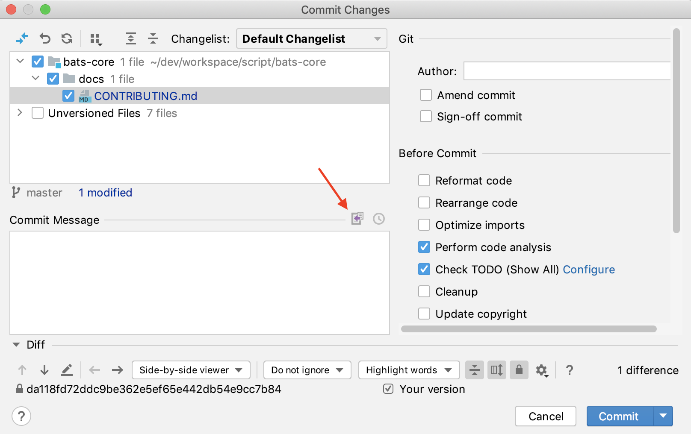
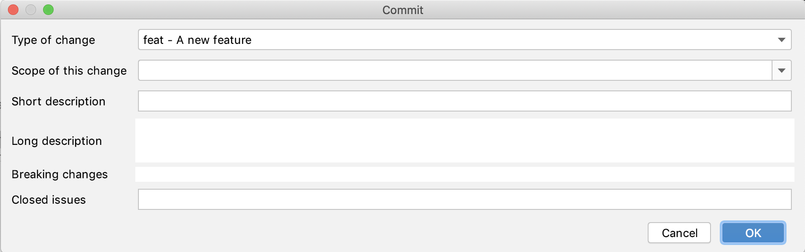

# How to contribute

## Welcome!
:+1::tada: First off, thanks for taking the time to contribute! :tada::+1:

## Code of Conduct

This project and everyone participating in it is governed by the [Code of Conduct](CODE_OF_CONDUCT.md). By participating, you are expected to uphold this code.

## CI test matrix

Use the [CI test matrix](docs/coverage.md#ci-test-matrix) to distinguish runner
operating systems, tested interpreters, full-suite and selected test runs, and
coverage report destinations. Keep it aligned with changes to the workflow and
test entry points. A 100% line union is not a per-environment test guarantee.

## Submit an issue

Search the existing issues before opening a report or suggestion on the
[issues page](https://github.com/renault-digital/bash-base/issues/new/choose).

For a bug report, include a minimal reproduction, expected and actual behavior,
the Bash-base version or commit, the actual Shell and its version, the operating
system, and the installation/loading method. Include stdout, stderr and exit
status when relevant. Use the [bug report template](.github/ISSUE_TEMPLATE/bug_report.md)
and remove credentials and other sensitive information from examples and logs.

For a feature request, describe the task and the difficulty first. Unknown
implementation details are not a reason to withhold a useful use case.

## Proposing a feature

Consult the [roadmap](docs/roadmap.md) for current priorities, dependencies and
acceptance criteria. A roadmap entry is an investigation direction, not an
approved API or a guaranteed release. Record actionable tasks and results in
issues and pull requests.

Start with the [design principles](docs/design-principles.md). Bash-base accepts
features to reduce recurring command-composition and scripting costs, not to
maximize the number of helpers or reproduce another language's standard library.

Use the [feature request template](.github/ISSUE_TEMPLATE/feature_request.md) and
describe a concrete task, the difficulty it creates, and the approaches already
considered. A request does not need a finished API design or implementation;
identify unknowns explicitly so they can be discussed.

Before merging an implementation, the contributor and maintainer should resolve:

| Question | Evidence expected for implementation review |
| --- | --- |
| What recurring problem does this solve? | A representative use case and the research, implementation, verification or maintenance work it avoids. |
| Why does this belong in Bash-base? | A clear connection to command arguments, outputs, execution or automation logic; comparison with built-ins, existing helpers and external tools. |
| What is the public contract? | Inputs, outputs, exit statuses, side effects, input boundaries and a realistic composition example. |
| What supports its reliability? | Relevant regression, boundary-input and supported-environment tests, including error paths. |
| What changes for existing users? | A compatibility assessment, any migration requirements, dependencies and maintenance costs. |

Preserve the existing regression and mandatory coverage gates. Coverage is
necessary evidence, not proof of all branches, inputs or security properties.
Do not relax a gate or silently change an existing API to make a new feature fit.

Document public helper behavior in its source comments as required by the
existing LiveDoc workflow. Keep shared design principles in the design-principles
reference and feature-specific rationale in the issue or pull request; neither
replaces generated API documentation.

## Code Contribution

Code, tests, documentation and CI improvements can be submitted through pull requests.

A pull request should remain focused in scope and avoid containing unrelated commits.

### Validation and compatibility

Behavior changes must include appropriate regression and boundary tests for the
supported environments. Preserve existing Bash behavior and the documented
Bash/zsh compatibility boundary; proposed design principles do not silently
change a current helper's contract.

Keep the existing regression, compatibility and mandatory 100% measurable-line
coverage gates. Do not weaken a gate, hide uncovered code or add meaningless
tests merely to obtain a passing result. Coverage does not establish complete
branch coverage, arbitrary-input safety or the absence of security defects.

Documentation-only changes do not require artificial test-suite changes when
executable behavior is unchanged. Explain that scope in the pull request and
validate the changed text, examples, links or metadata as appropriate. This is
not an exemption from the required CI status checks or coverage gate.

Record the commands actually run, their results, and relevant Shell/OS versions.
Distinguish completed checks from pending CI and checks that were not run. Do
not equate a local check or a release preview with a successful real publish.

Review the current release configuration before merging, including documentation
changes. Do not assume a `docs:` commit is excluded from release automation.

### Understand the technology stack

- Works with git, npm and docker

- Bash best practices
    - Audit shell script with [shellcheck](https://www.shellcheck.net/)
    - Format shell script with [shfmt](https://github.com/mvdan/sh)
    
- BDD
    - BDD test with [ShellSpec](https://shellspec.info)
    - Code coverage with [Kcov](http://simonkagstrom.github.io/kcov/index.html) and [codecov](https://codecov.io)
    - 100% measurable-source-line coverage under the required coverage gate

- Respect [Semantic Versioning 2.0.0](https://semver.org/) and [Conventional Commits 1.0.0](https://www.conventionalcommits.org/en/v1.0.0/)
    - Help input commit message 
        - CLI: with [Husky](https://github.com/typicode/husky) and [Commitizen](http://commitizen.github.io/cz-cli)
        - IntelliJ IDEA: plugin [Git Commit Template](https://plugins.jetbrains.com/plugin/9861-git-commit-template)
    - Audit commit message with [Commitlint](https://commitlint.js.org) for CI/CD pipeline, local lint and git hook `commit-msg`
    
- LiveDoc:
    - The comment of functions respect the [man page](https://en.wikipedia.org/wiki/Man_page) standards and conventions and use the 5 basic sections (NAME, SYNOPSIS, DESCRIPTION, EXAMPLES, SEE ALSO) 
    - Format and audit the comment by bash-base function `doc_lint_script_comment`
    - Generate docs/references.md from function comments by bash-base function `doc_comment_to_markdown`
    - Generate man page bash-base.1 from docs/references.md by [pandoc](https://pandoc.org)
    
- Automatically release a new version with [semantic release](https://semantic-release.gitbook.io/) if need:
    - Analyser the commit message to decide the new version
    - Generate release note
    - Generate&Update CHANGELOG.md
    - Generate&Update bin/bash-base from src/*.sh
    - Build docker image
    - Lint man-styled script comment
    - Generate docs/references.md and man/bash-base.1
    - Tag and Release on Github
    - Push new release to [npm Registry](https://www.npmjs.com)
    - Push new release to [docker hub](https://hub.docker.com)
    
- CICD Workflow config with [NPM](https://docs.npmjs.com/about-npm/) and [Github actions](https://docs.github.com/en/actions)
    

### Notes

- in commit message template, the default issuePrefixes: `['#']`

- in CLI (not intelliJ plugin), when do a `git commit`, `git merge`, `git rebase` or other operation, even we explicitly provide commit message, the `prepare-commit-msg` hook will still be revoked and the `commitizen` will show the prompts. We can just press `Ctrl + C` to skip it and it comes to `commit-msg` hook.

- Don't modify the files `bin/`, `man/` and `docs/references.md`, they will generated automatically by semantic-release.


### How to do it?

1. Submit an issue, get the issue number, and assign it to you.

1. Clone the repository branch `master`. If you clone a while ago, get the latest changes from upstream.

1. Create your branch:

    ```
    git checkout -b <your-branch-name>
    ```
   
1. Setup dev environement

    ```
    npm ci
    ```

1. Make the focused change. Add or update tests for behavior changes and preserve the mandatory coverage gate. For documentation-only changes, follow the validation requirements above instead of adding unrelated tests.

1. Commit your changes in logical chunks. Please see the [commit message guidelines](https://github.com/angular/angular.js/blob/master/DEVELOPERS.md#-git-commit-guidelines).

    ```
    git commit
    ```
    Fill the info (including the issue number) for each step of wizard.
    
    If you prefer IntelliJ IDEA, the plugin [Git Commit Template](https://plugins.jetbrains.com/plugin/9861-git-commit-template) is proposed.
    
    
    
    
    
1. Push your changes and the hook will verify the result in local:
                                       
   ```
   npm test
   npm run lint
   # npm run lint:commit
   # Optional local coverage diagnostic; not a replacement for the required gate:
   # npm run test:coverage
   ```
    
1. Open a pull request with a clear title and description in template
